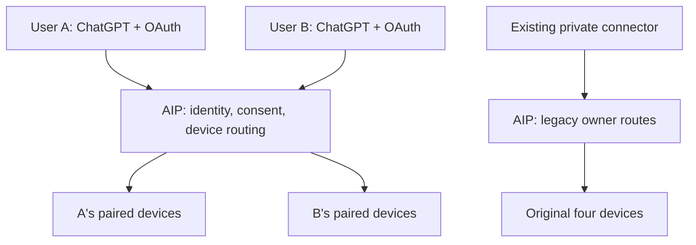

# Remote Commander

Self-hosted MCP file, search, and terminal tools for Windows, macOS, and Linux.

**One AIP gateway, separate user accounts, separate device permissions.** Each user registers an account, pairs their own machines, and authorizes their own ChatGPT connection. A new account starts with no devices. The existing owner's private ChatGPT connector remains separate.

## Join an existing gateway

Ask the gateway operator for its **HTTPS portal URL**. The repository URL is source code, not a running shared service.

1. Open the portal and select **Create account**. Use a unique username and a password of at least 12 characters.
2. Sign in, choose a device name, and download its one-time pairing file.
3. On that machine, install Python 3.11+ and OpenSSH (`ssh` and `ssh-keygen`), then clone this repository:

```sh
git clone https://github.com/WuZiyong/remote-commander.git
cd remote-commander
python3 setup_device.py --invite /path/to/pairing-invite.json
```

On Windows use `py -3.12 setup_device.py --invite "C:\Users\you\Downloads\pairing-invite.json"`. If Python 3.11+ is already on PATH, `python` works too.

The installer creates a virtual environment, generates a device key locally, consumes the invitation, and installs a service for the current OS user. No AIP password, administrator SSH key, or GitHub login is needed.

File access defaults to your home directory. Add repeatable `--root PATH` options to narrow it. Terminal commands are disabled unless you add `--allow-shell`; when enabled, they run with your full OS account permissions. Use `--port 18766` if the default local port is occupied.

4. Refresh the portal: the device appears automatically and reports connected/offline status. **Remove device** immediately blocks new gateway calls and removes its gateway SSH authorization. **Disconnect all OAuth clients** revokes that account's ChatGPT tokens.
5. Add the operator's `https://YOUR-GATEWAY/mcp` URL as a custom MCP server in ChatGPT, select OAuth with **dynamic client registration (DCR)**, sign in to your own gateway account, and approve the client. See [ChatGPT setup](docs/CHATGPT.md).

Pairing files are credentials: keep them private, use them within 30 minutes, and delete any leftover copies. The installer deletes the JSON it successfully consumes. Never upload it to GitHub.

## Architecture and permissions



OAuth subjects are generated by the gateway after login. Request headers, form fields, device names, and tool arguments cannot select another owner. Device identifiers are namespaced before registration; agent URLs and reverse-tunnel ports are allocated by AIP. Every routed call looks up the authenticated owner's current device set.

The legacy private relay only discovers the legacy owner's devices. It must **stay private**; publishing or sharing that relay is not the multi-user deployment procedure.

The AIP OS administrator is trusted and can read gateway state. User isolation is an application permission boundary, not isolation from the gateway administrator. Ordinary users never receive access to the AIP agent or an AIP shell.

## Deploy or upgrade the gateway

The gateway stays on AIP. No replacement server is required. Use a dedicated HTTPS hostname on that gateway and the existing restricted SSH pairing endpoint.

- [Deployment, upgrade, backup, rollback](deploy/MULTIUSER.md)
- [Security model and reporting](SECURITY.md)
- [Existing private AIP installation](deploy/AIP.md)
- [Legacy single-owner agent/gateway and tool reference](docs/LEGACY_SINGLE_OWNER.md)
- [Device connector and OS startup behavior](deploy/ENROLLMENT.md)

The portal binds only to `127.0.0.1`. Public access requires a real TLS reverse proxy; a repository checkout or a loopback staging service does not make the service available to other people.

## Development and verification

```sh
python3 -m venv .venv
.venv/bin/python -m pip install -c constraints.txt -e '.[dev]'
.venv/bin/python -m pytest -q
.venv/bin/ruff check src tests scripts setup_device.py
.venv/bin/ruff format --check src tests scripts setup_device.py
```

On Windows substitute `.venv\Scripts\python.exe`. CI runs Python 3.11 and 3.13 on Linux, macOS, and Windows. Tests include real HTTP agents, OAuth PKCE, code replay, client and resource binding, credential revocation, all 18 device-bound tools, foreign process/search sessions, and additive migration of the original registry.

Use `scripts/stage_multiuser.py --state .runtime/NEW-STAGE --port 18890` with the installed virtual-environment Python to launch an isolated loopback portal. It uses a different registry and SSH key file; it cannot enroll a real device through production SSH. Run the test suite for full agent integration. Do not expose the local HTTP test mode.

This project is provided under the [MIT license](LICENSE). Do not commit credentials, runtime state, invitation bundles, or a deployment's private Sites project metadata.
